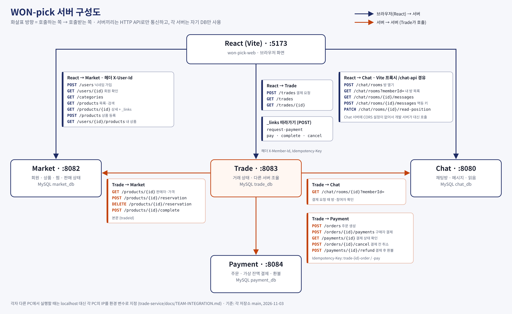
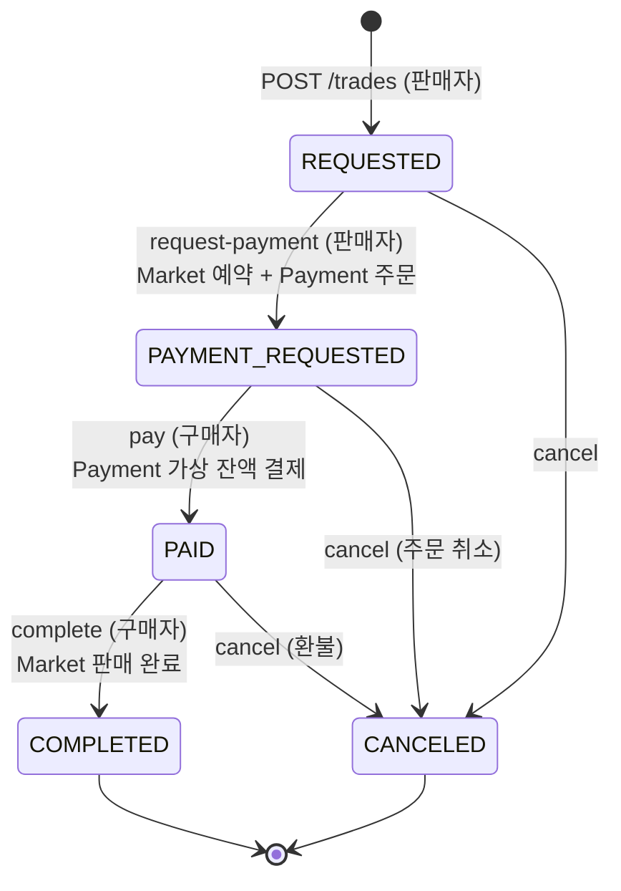

# WON-pick Trade 서버

우리WON 청년 IT 아카데미(A·B반) 교내 중고거래 서비스 **WON-pick**의 거래 서버입니다.
판매자가 채팅방에서 보낸 결제 요청부터 구매자의 모의 결제와 구매 확정까지 거래 상태를 관리하고, Market·Chat·Payment를 차례로 불러 하나의 거래로 묶습니다.

| 항목 | 값 |
| --- | --- |
| 포트 | `8083` |
| 기술 | Java 17 · Spring Boot 4.1 · JdbcClient · MySQL · springdoc(Swagger) |
| DB | 담당 PC의 `localhost:3306/trade_db` (없으면 자동 생성) |
| 결제 | 실제 카카오페이 대신 Payment 서버의 **가상 잔액**(회원당 1,000,000원) |
| 화면 | [won-pick-web](https://github.com/won-pick/won-pick-web) |

**목차** · [구성](#구성) · [거래 상태](#거래-상태) · [API](#api) · [실행](#실행) · [테스트와 커버리지](#테스트와-커버리지) · [설계 메모](#설계-메모) · [폴더 구조](#폴더-구조) · [문서](#문서)

## 구성



- 화면은 Trade를 직접 부릅니다. 판매자가 채팅방에서 **결제 요청 보내기**를 누르면 `POST /trades`가 호출됩니다.
- Trade는 Market에서 판매자·가격·판매 상태를, Chat에서 채팅방 참여자를 확인한 뒤 상품을 예약하고 Payment 주문을 만듭니다.
- 금액과 판매자는 화면이 보낸 값을 믿지 않고 Market 조회값으로 정합니다.
- 결제·구매 확정·취소 알림 메시지는 화면이 Chat에 남깁니다. Trade는 Chat에 메시지를 보내지 않습니다.

## 거래 상태



- `POST /trades`는 보통 REQUESTED를 거쳐 곧바로 PAYMENT_REQUESTED까지 진행합니다.
- 예약이나 주문 단계에서 다른 서버가 응답하지 않으면 거래는 REQUESTED에 남습니다. 판매자는 같은 요청을 다시 보내거나 `request-payment`로 이어서 진행하고, 둘 다 원하지 않으면 취소할 수 있습니다.
- 구매 확정 전까지는 구매자와 판매자 모두 취소할 수 있습니다. 결제한 뒤에 취소하면 환불되고, 상품은 다시 판매 중이 됩니다.

응답의 `_links`에는 **지금 보는 사람이 할 수 있는 행동**만 들어 있습니다. 화면은 이 링크가 있을 때만 버튼을 그립니다.

| 상태 | 판매자 | 구매자 |
| --- | --- | --- |
| REQUESTED | `request-payment`, `cancel` | `cancel` |
| PAYMENT_REQUESTED | `cancel` | `pay`, `cancel` |
| PAID | `cancel` | `complete`, `cancel` |
| COMPLETED | 없음 | 없음 |
| CANCELED | 없음 | 없음 |

항상 `self`, `product` 링크가 있고, 끝나지 않은 거래에는 `chat`, 주문이 있는 거래에는 `payment` 링크가 붙습니다.

## API

모든 요청에 회원 번호 헤더 `X-Member-Id`가 필요합니다. Swagger: `http://localhost:8083/swagger-ui.html`

| 메서드·주소 | 누가 | 결과 |
| --- | --- | --- |
| `POST /trades` | 판매자. 본문 `{productId, buyerId, chatRoomId}`, `Idempotency-Key` 권장 | 새 거래는 201, 같은 키나 이미 열린 거래는 200 |
| `GET /trades` | 당사자. `role`·`status`·`productId`·`chatRoomId`로 거름 | `{trades, _links}`, 최신순 |
| `GET /trades/{id}` | 당사자 | 거래 + 보는 사람 기준 `_links` |
| `POST /trades/{id}/request-payment` | 판매자 | REQUESTED에서 멈춘 예약·주문 재개 → PAYMENT_REQUESTED |
| `POST /trades/{id}/pay` | 구매자 | 모의 결제 → PAID |
| `POST /trades/{id}/complete` | 구매자 | 구매 확정 → COMPLETED, Market 상품 SOLD |
| `POST /trades/{id}/cancel` | 당사자. 선택 본문 `{reason}` | 주문 취소 또는 환불, Market 예약 해제 → CANCELED |

이미 그 상태에 도착한 거래에 같은 행동을 다시 보내면 오류 없이 현재 거래를 돌려줍니다. 결제나 환불이 두 번 일어나지 않습니다.

### Trade가 부르는 다른 서버 API

| 대상 | 호출 | 쓰는 때 |
| --- | --- | --- |
| Market | `GET /products/{id}` | 거래 생성: 판매자·가격·판매 상태 확인 |
| Market | `POST /products/{id}/reservation` · `DELETE …/reservation` | 예약 / 취소 시 해제 (본문 `{tradeId}`) |
| Market | `POST /products/{id}/complete` | 구매 확정 |
| Chat | `GET /chat/rooms/{id}?memberId=` | 거래 생성: 방의 상품·참여자 확인 |
| Payment | `POST /orders` | 주문 생성 (`Idempotency-Key: trade-{id}-order`) |
| Payment | `POST /orders/{id}/payments` | 결제 (`idempotencyKey: trade-{id}-pay`) |
| Payment | `GET /payments/{id}` → `POST /orders/{id}/cancel` 또는 `POST /payments/{id}/refund` | 취소할 때 실제 결제 상태를 보고 주문 취소 또는 환불 |

요청·응답 본문은 [통합 규격](docs/TEAM-INTEGRATION.md#서버-간-계약)에 있습니다.

### 오류 응답

모든 실패는 `ProblemDetail`에 `code`를 더한 모양입니다.

```json
{ "type": "about:blank", "title": "거래 상태 오류", "status": 409,
  "detail": "COMPLETED 상태에서 수행할 수 없는 요청입니다.", "instance": "/trades/1/cancel", "code": "INVALID_STATUS" }
```

| HTTP | code | 언제 |
| --- | --- | --- |
| 400 | `INVALID_INPUT` | 필수값 누락, 0원 이하 상품, 기존 거래와 다른 채팅방 |
| 403 | `NOT_TRADE_PARTICIPANT` · `ROLE_NOT_ALLOWED` | 당사자가 아님 · 다른 역할의 행동 (판매자가 `pay` 등) |
| 404 | `TRADE_NOT_FOUND` · `PRODUCT_NOT_FOUND` | 없는 거래 · 없는 상품 |
| 409 | `PRODUCT_NOT_AVAILABLE` · `INVALID_STATUS` | 판매 중이 아니거나 다른 구매자와 거래 중 · 지금 상태에서 할 수 없는 행동, 키 재사용 |
| 422 | `SELF_PURCHASE` · `PAYMENT_REJECTED` | 본인 상품 · 잔액 부족 등 결제·환불 거절 |
| 502 | `UPSTREAM_UNAVAILABLE` | Market·Chat·Payment에 연결 실패 (연결 2초, 응답 3초 제한) |

## 실행

MySQL을 켜 둔 상태에서 실행합니다. DB(`trade_db`)와 테이블은 서버가 시작할 때 자동으로 만듭니다.

### 담당 PC에서 Trade만 실행 (팀 연동)

```powershell
$env:MARKET_SERVER_URL='http://<MARKET_PC_IP>:8082'
$env:CHAT_SERVER_URL='http://<CHAT_PC_IP>:8080'
$env:PAYMENT_SERVER_URL='http://<PAYMENT_PC_IP>:8084'
$env:TRADE_CORS_ALLOWED_ORIGINS='http://localhost:5173,http://<FRONTEND_PC_IP>:5173'
.\gradlew.bat bootRun
```

| 환경 변수 | 기본값 | 설명 |
| --- | --- | --- |
| `MARKET_SERVER_URL` · `CHAT_SERVER_URL` · `PAYMENT_SERVER_URL` | `http://localhost:8082` · `:8080` · `:8084` | 각 담당 PC 주소 (`MARKET_URL` 같은 예전 이름도 읽음) |
| `TRADE_CORS_ALLOWED_ORIGINS` | `http://localhost:5173,http://localhost:3000` | 화면 Origin, 쉼표로 여러 개 |
| `TRADE_DB_URL` · `DB_USERNAME` · `DB_PASSWORD` | `localhost:3306/trade_db` · `root` · `1234` | 연결 정보를 바꿀 때만 |
| `PORT` | `8083` | |

다른 PC가 Trade를 부를 수 있도록 Trade PC의 방화벽에서 8083 포트를 엽니다(관리자 PowerShell, 한 번만).

```powershell
New-NetFirewallRule -DisplayName "WON-pick Trade" -Direction Inbound -Protocol TCP -LocalPort 8083 -Action Allow
```

PC별 주소·DB·CORS 전체 표와 확인 시나리오는 [통합 규격](docs/TEAM-INTEGRATION.md)에 있습니다.

### PC 한 대에서 전부 실행 (혼자 시연)

저장소 5개(`market-service`, `chat-service`, `trade-service`, `payment-service`, `won-pick-web`)를 같은 폴더에 두고 실행합니다. 없는 저장소는 스크립트가 clone합니다.

```powershell
scripts\run-all.cmd          # 서버마다 창이 하나씩 열림 → http://localhost:5173
scripts\run-all.cmd -Pull    # 시작 전에 모든 저장소 git pull
scripts\run-all.cmd -Share   # 강의장 다른 PC에서도 http://<내 IP>:5173 으로 접속
scripts\stop-all.cmd         # 모두 끄기
```

### 다른 서버 없이 실행

| 프로필 | 가짜로 대신하는 것 | 실행 |
| --- | --- | --- |
| `stub` | Market·Chat·Payment 전부 (Trade 안의 `/stub/**`) | `.\gradlew.bat bootRun --args="--spring.profiles.active=stub"` |
| `stub-pay` | Payment만 | `.\gradlew.bat bootRun --args="--spring.profiles.active=stub-pay"` |

`stub`에서는 채팅방 번호가 상품 번호와 같고, 판매자는 100번, 구매자는 3번입니다. 이 프로필에서도 Trade DB는 필요합니다.
[HTTP 예시](http/trade-flow.http)로 결제 요청부터 구매 확정까지 따라 해 볼 수 있습니다. 실제 연동할 때는 프로필을 켜지 않습니다.

## 테스트와 커버리지

MySQL과 다른 서버 없이 실행됩니다. 테스트는 H2 메모리 DB, 로컬 HTTP 계약 서버, Mockito를 씁니다.

```powershell
.\gradlew.bat serviceTest              # TradeService 단위 테스트 + Service 커버리지 리포트
.\gradlew.bat test                     # 전체 테스트 (HTTP 계약·도메인·Service)
.\gradlew.bat test jacocoTestReport    # 전체 테스트 + 전체 코드 커버리지
```

| 테스트 | 범위 |
| --- | --- |
| `service/TradeServiceTest` | BDDMockito 단위 테스트. 역할·상태 검사, 외부 호출 순서, 실패 시 저장하지 않음, 멱등 재요청, 롤백 |
| `TradeContractTest` | 서버를 띄우고 가짜 Market·Chat·Payment와 HTTP로 주고받는 계약 테스트 |
| `domain/TradeStatusTest` | 상태 전이 규칙 |

2026-10-29 측정 결과 ([스냅샷](docs/coverage/service/README.md), 이후 자동 갱신되지 않음):

| 측정 범위 | 테스트 수 | 라인 | 분기 |
| --- | --- | --- | --- |
| Service 패키지 (`serviceTest`) | 73개 통과 | 94/94 = 100% | 60/60 = 100% |
| 전체 운영 코드 (`test`) | 84개 통과 | 413/493 = 83.77% | 148/199 = 74.37% |

Service 100%는 Service 패키지만 분모로 잡은 값이라 서버 전체 수치가 아닙니다. 실제 DB 갱신·동시 요청·네트워크 유실은 단위 테스트가 보장하지 않습니다. 자세한 내용은 [Service 테스트 가이드](docs/SERVICE-TEST-GUIDE.md)에 있습니다.

## 설계 메모

- **멱등 키** — 판매자의 같은 버튼 누름을 다시 보내면 같은 거래를 돌려줍니다. 같은 키를 다른 요청에 쓰면 409입니다. Payment에는 거래 번호로 만든 키(`trade-{id}-order`, `trade-{id}-pay`)를 보내서 재시도해도 결제는 한 번만 됩니다.
- **조건부 UPDATE** — `UPDATE … WHERE status = ?`로 상태를 바꾸고, 바뀐 행이 있을 때만 이력을 남깁니다.
- **실패하면 저장하지 않음** — 외부 호출이 성공한 다음에 상태를 저장합니다. 예약 응답이 유실될 수 있으므로 실패했다고 예약을 임의로 풀지 않고, REQUESTED에 남겨 같은 거래 번호로 다시 시도하게 합니다.
- **한 인스턴스 기준** — 변경 요청은 서버 안에서 직렬화합니다. Trade를 여러 대로 늘리려면 DB 기반 잠금이 필요합니다.
- **HATEOAS** — 링크 계산(`TradeLinkAssembler`)과 실제 검사(`TradeService`)가 같은 `TradeStatus` 메서드를 씁니다. 그래서 "버튼은 보이는데 누르면 409"가 생기지 않습니다.

## 폴더 구조

```
src/main/java/com/wonpick/trade/
├── controller/   TradeController — HTTP 입구, 검사·예외 처리 없음
├── service/      TradeService — 역할·상태 검사, 외부 호출 순서, 트랜잭션
├── client/       MarketClient · ChatClient · PaymentClient — RestClient, 시간 제한, 502 변환
├── hateoas/      TradeLinkAssembler — 상태·역할별 _links
├── domain/       Trade · TradeStatus(전이 규칙) · TradeRole
├── repository/   TradeRepository · IdempotencyKeyRepository — JdbcClient SQL
├── dto/          요청·응답 모양
├── exception/    ErrorCode · GlobalExceptionHandler(ProblemDetail + code)
├── config/       다른 서버 주소, CORS, Swagger
└── stub/         stub 프로필용 가짜 Market·Chat·Payment
src/main/resources/
├── application.yml · application-stub.yml · application-stub-pay.yml
└── schema.sql    trades · trade_idempotency_keys · trade_status_histories
```

## 문서

| 문서 | 내용 |
| --- | --- |
| [docs/TEAM-INTEGRATION.md](docs/TEAM-INTEGRATION.md) | PC별 주소·DB·CORS, 서버 간 요청 형식, 재시도 규칙, 팀 확인 시나리오 |
| [docs/SERVICE-TEST-GUIDE.md](docs/SERVICE-TEST-GUIDE.md) | Mock과 실제 객체 구분, Given–When–Then, 요구사항별 테스트, 커버리지 읽는 법 |
| [docs/coverage/service/](docs/coverage/service/README.md) | 2026-10-29 Service 커버리지 HTML 스냅샷 |
| [http/trade-flow.http](http/trade-flow.http) | IntelliJ HTTP Client로 따라 하는 거래 흐름 |
